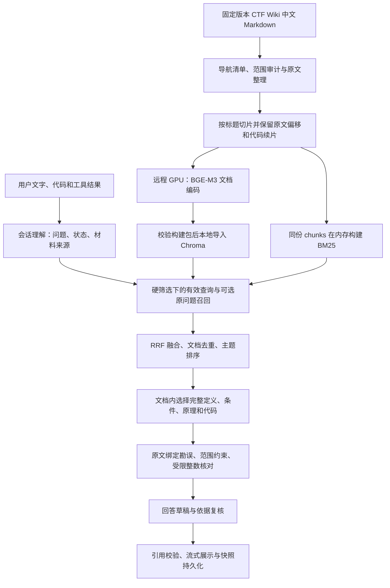

# 项目技术总结：CTF Wiki 多轮 RAG 助手

记录日期：2026-10-17。本文依据当前源码、已导入索引 manifest 和 v15 实际验收记录整理。它是当前实现的技术说明，不代表所有规划均已实现。历史安全知识库的方案与指标单独列在文末，不能与 CTF 结果混用。

## 1. 项目目标与整体技术路线

项目目前主要提供一个本地 CTF 思路助手：用户粘贴题面、代码或工具输出，系统结合固定版本的 CTF Wiki，解释知识、给分析提示、展开步骤，并在多轮对话中保留已确认条件和操作结果。

主流程是手写 Python RAG，不会自主联网或运行解题脚本。后端采用 FastAPI，前端采用 React 19、TypeScript、Vite，以 SSE 返回阶段事件和流式答案；SQLite 保存本地会话。生成服务通过 OpenAI 兼容协议调用，Embedding 则由本地/远程的 Sentence Transformers 编码器承担。



这里有两个不同阶段：建库阶段编码所有文档片段；问答阶段只编码查询，不会为每个问题重建检索库。此次优化调整了查询、排序、上下文组织和回答流程，没有重新切片或重新编码整库。

## 2. 知识来源与数据处理

来源为 CTF Wiki，固定 commit 为 `e225ddfcd420a7f54a5940f47336ebdf8c29b875`，中文根目录为 `docs/zh/docs`。源码和模型分别通过 `data/ctf/source-lock.json`、`data/ctf/model-lock.json` 固定版本。

- 中文 Markdown 共 400 个，391 个入库，9 个按清单明确排除，包括站点元资料及上游空文件；最终 3834 个片段。
- 依据目录与 MkDocs 导航保留方向归属，例如 Web、Misc、Reverse、Crypto、Pwn；一个页面可有多个归属。
- 文档记录稳定 ID、标题、语言、原文、相对路径、导航、网页 URL、固定 commit 的源码 URL、内容哈希等。
- 代码、公式、表格和 Markdown 正文保留；图片记录链接，构建包可携带本地静态资源，但没有 OCR、图片向量化，也没有递归抓取外链。
- 部分非空页面只有标题或待补充说明。完整处理来源清单不等于每页均能支持详细回答；此类查询应说明正文不足。

处理入口是 `secrag/ctf_wiki.py`。导出时校验页面清单闭合、原文版本一致，并检查片段能够重建原文，不能静默跳过处理失败的页面。来源锁记录许可证为 CC-BY-NC-SA-4.0。

## 3. RAG 切片策略：ctf-v1

实现：`secrag/ctf_chunker.py::chunk_ctf`。当前库只使用 CTF 专用策略。

### 3.1 按标题层级拆分，而非机械滑窗

先识别代码围栏之外的 Markdown 标题，维护层级路径，例如 `PNG 格式 > 文件结构 > IHDR`。片段不跨越已识别的小节边界；小节过长时再细分。

单片默认上限为 **1800 个 Python 字符**，不是 1800 tokens。达到长度边界时，优先选后段的空行/段落边界，其次选完整换行；遇到超长单行才按字符边界截开。

当前 CTF 策略**没有固定长度 overlap**。用精确原文范围、标题路径和代码续片关联保存上下文关系，避免把旧版通用切片中的 overlap 参数误写为现状。

### 3.2 原文与展示文本分开保存

每个片段包含：

- `id = doc_id#ordinal`，同时保存 `doc_id`、`ordinal`、`section`、方向和来源信息。
- `source_start/source_end`：在原文字符串中的字符偏移，采用右开区间，不是 UTF-8 字节偏移。
- `source_text`：该区间未经改写的原文。
- `text`：用于展示和送入上下文的文本，必要时补齐代码围栏。
- `embedding_text`：`文档标题 + 标题路径 + 换行 + text`，让向量与关键词检索都能看到章节语义。

切片后强制检查按序拼接全部 `source_text` 等于整篇原文。补齐的围栏不写回 `source_text`。

### 3.3 长代码可以跨片，但必须可恢复

扫描时跟踪反引号或波浪线围栏状态，代码块里的 `#` 不当作章节标题。跨片代码通过 `continued_code/continues_code` 标记，展示时补开闭围栏。

检索命中代码中段后，上下文选择器会向前、向后恢复整条代码续片链。若无法恢复完整链，或整组放不下预算，整组跳过并记录原因，不把半段代码当作完整算法依据。

## 4. Embedding 与离线建库

### 4.1 当前实际模型与编码方式

- 模型：`BAAI/bge-m3`。
- 固定 revision：`5617a9f61b028005a4858fdac845db406aefb181`。
- 使用 `SentenceTransformer.encode` 输出 **1024 维稠密向量**。
- 当前模型最大序列长度为 **8192 tokens**；这与 1800 字符切片上限是不同单位。
- 建库显式设置 `normalize_embeddings=False`，向量保存为 `float32`；查询端使用相同模型和序列长度。相似性由 Chroma 的余弦距离计算，并未改用点积距离。
- 没有使用 BGE-M3 的 learned sparse、ColBERT 多向量，也没有将 BM25 描述为 BGE-M3 的稀疏输出。

### 4.2 远程编码、本地检索

`tools/run_ctf_remote.py` 和 `secrag/remote_build.py` 负责远程作业，默认批量大小为 8，使用 CUDA。文档 Embedding 的输入是 `embedding_text`，不是只编码裸正文。

构建前用 tokenizer 检查实际输入是否超过模型上限，超限直接报错，禁止静默截断。向量缓存按模型、revision、最大序列长度、归一化配置和输入文本哈希复用；已缓存向量还要校验维度与数值有效性。

本次完整导出记录为 391 篇、3834 个向量，其中新增编码 3645 个、复用缓存 189 个；导出耗时 48.704 秒。该时间只反映那次远程构建，不含下载、环境安装和本地导入，不是日常问答时延。

构建包保存 `docs.jsonl`、`chunks.jsonl`、`vectors.npy`、覆盖报告、来源锁、许可证及资源。`index_manifest.json` 记录模型、维度、切片版本、来源 commit 和文件 SHA-256。导入前核验文件与向量，再写入独立本地目录。

当前数据位于 `data/experiments/ctf_wiki_v1/`，Chroma 位于 `chroma_ctf_wiki_v1/`。本地查询编码器可校验并复用 `data/models/bge-m3/`；应用没有显式指定查询设备，因此实际由 Sentence Transformers/本机可用设备决定，不能写成“所有查询都在远程 GPU 运行”。

## 5. 索引与检索方式

实现：`secrag/store.py`、`secrag/retriever.py`、`secrag/ctf_retrieval.py`。

### 5.1 两条召回通道

**向量通道**：用户有效查询经同款 BGE-M3 编码，调用本地 Chroma 持久化集合。当前代码设置 HNSW 的 `space=cosine`、`ef_construction=400`、`ef_search=400`、`max_neighbors=32`；返回分数为 `1 - distance`。这些是近似近邻索引参数，不是生成模型参数。

**BM25 通道**：启动时基于同一份 `chunks.jsonl` 构造内存 `BM25Okapi`，分词采用 `jieba.lcut_for_search` 并统一小写。BM25 同样优先读取 `embedding_text`，与向量端按同一 chunk ID 对齐。

CTF 生产召回固定使用混合路线，每个查询向量与 BM25 默认各取 **30 个候选片段**。

### 5.2 RRF 与文档层排序

第一层按 chunk ID 使用 RRF：`score = Σ 1/(60 + rank)`，rank 从 1 起。它融合的是排名，不把 BM25 原始分数和余弦分数直接相加，也不是相关性概率或已校准的拒答阈值。

融合后按 `doc_id` 去重，每篇文档先保留代表锚点。CTF 再根据标题、路径、小节里的明确技术主体以及基础定义需求调整文档排序，例如 PNG、RSA、栈的作用等。这是启发式主题排序，不是训练出的 cross-encoder。

虽然通用代码支持 `bge-reranker-v2-m3`，当前 CTF 网页与问答入口显式 `use_reranker=False`，不应把可选能力写成已开启。

### 5.3 有效查询与原问题的有界融合

会话理解器将多轮问题解析成可独立检索的有效查询。检索层先取该查询前 **10 篇文档**。

为避免改写丢失主体，也会在满足条件时探测原问题：去掉代码围栏内容，长度不超过 1000 字符，不是快捷操作，也不是“第二点”等编号指代。原问题含明确英文技术词，或其首个具体中文主题能匹配召回标题时，才参与融合。

参与时执行第二层文档级 RRF：原问题排名投两票，有效查询投一票，再取前 **5 篇文档**。不满足独立主体条件的原问题探测只留诊断轨迹，不挤占有效查询排名。这里的 5 是文档数，不是最终证据片段数。

### 5.4 硬筛选发生在召回之前

来源、语言和方向先限制片段集合。BM25 在范围内重建/缓存，Chroma 通过 metadata `where` 约束；同文档补上下文也只读取这个范围。筛选视图最多缓存 16 组。

多方向选择取交集命中意义上的“任一所选方向”，同时与来源/语言条件组合。不因答案资料不足就自动扩大筛选。只选 Reverse 时，不能偷偷补 Misc 的 PNG 专节。

## 6. 上下文选择：召回命中不等于证据完整

实现：`select_ctf_context`，当前策略标识 `ctf-context-v3`。

从选中的文档锚点出发，重新读取范围内该文档的小节，结合问题和小节标题挑选依据。定义题优先基础定义、密钥生成、加解密关系；宽泛方法题兼顾多个方法；偏移和结构题补字段定义表。

选中一个案例或步骤时，补入其有实质正文的父级定义、同方法条件/原理/限制，以及完整代码链。依赖组按整体选入或整体跳过，不以字符串截断方式塞满预算。

最终最多 **8 个片段、约 16000 字符的估算预算**，预算包含正文、小节和固定开销；它不是精确 token 预算。轨迹记录候选、选入/截断文档、选中片段、选择理由与跳过原因。

这种策略改善了“召回理论页但漏基础定义”“方法例题脱离适用条件”“代码只选到后半段”等问题，但仍依赖上游召回：关键文档没进来，文档内补片不能凭空恢复它。

## 7. 多轮状态、可靠性与生成流程

实现：`secrag/ctf_chat.py`、`secrag/ctf_reliability.py`。

### 7.1 有来源的会话状态

状态区分当前题目、观察、已尝试操作、假设、待确认项和原始材料 ID。观察/操作绑定用户消息 ID，并校验摘录与对应原话；助手建议不能直接升级为用户已经执行的操作。

只使用已完成轮次作为有效历史。用户更正条件或切换题目时更新状态、隔离旧材料；“第二点”根据最近助手回答解析，而不是去读 Wiki 的第二点。

当前入口文字上限为 16000 字符，选中的原始材料合计上限为 28000 字符，生成 payload 合计检查上限为 56000 字符；超出时要求缩小材料范围，不静默丢关键内容。

### 7.2 原 Wiki 勘误与适用范围

保持原资料不变，另外添加可审查勘误：匹配具体文档/小节或冲突内容，绑定引用片段 ID、原文哈希、权威出处和复核日期。典型问题包括 PHP 读取与代码求值混淆、RSA 的整数条件、IHDR 数据区与整块范围、ZipCrypto 与 AES，以及历史版本/ABI 的适用范围。

范围摘录和提示词帮助模型保留前提；程序还有少量确定性检查，例如特定 ABI 表述检查。这不是覆盖所有领域错误的规则引擎，也不保证 Wiki 已逐页审校。

### 7.3 受限整数核对

对用户提供的可支持表达式做 AST 白名单解释，限制整数位长、列表长度、节点数、深度和移位范围。没有 `eval/exec`，不导入模块、不调用用户函数、不读写文件。含不支持语句的整个代码块不进入核对，而不是只挑其中安全语句执行。

它核对的是有限的整数/列表运算，不是 Python 沙箱、通用程序运行器，也不能执行任意 C/RSA 大整数脚本。

### 7.4 生成、复核与引用

通常一个实质问题经过三次模型请求：会话理解 JSON、依据资料生成草稿、携同一证据与草稿生成复核后的流式答案。快捷步骤可复用状态，通常省去理解请求；本地边界拒答可能完全不调用模型。

模型收到的是用户材料、状态、编号 Wiki 证据、勘误、范围和核对结果。最终程序检查答案非空、引用编号存在；剔除代码里的数组下标等再解析 `[n]`。保存完整 `evidence_snapshot`，对外引用列表只展示实际引用的片段。

引用编号合法不等于语义必然支持，草稿复核也不能保证模型总正确，所以验收单独逐轮检查条件与引用支持。

“总结已尝试方法”使用验证后的用户原话确定性渲染，保留“未检查”“没有发现”等否定，不再调用模型改写总结。当前实现仍先走检索/上下文流程，因此不能描述为完全零检索的快捷路径。

## 8. 应用持久化与运行入口

网页会话保存到 `data/local/chat-ctf.sqlite3`。SQLite 开启 WAL、外键与事务；每个 session/request_id 唯一，每个会话只能有一个 running 请求，启动时将上次遗留 running 标记为 interrupted。失败或取消的半成品不会被当作有效完成轮参与后续推理。

本机已有环境和前端构建时，从项目根目录启动：

```powershell
.venv\Scripts\python.exe -m secrag.web --port 8766
```

访问 `http://127.0.0.1:8766/`。首次准备依赖/前端时参考 [CTF 应用说明](ctf-app.md)，依赖入口为 `requirements-ctf.txt` 和 `web/package.json`。生成模型配置从个人 `.env` 读取，本文不记录密钥；最近冻结验收实际使用 `qwen3.8-flash`，地址为 `https://maas.qianwenaiapi.com/compatible-mode/v1`。Embedding 模型与回答模型是两套独立配置。

CTF 是唯一应用 profile。知识库缺失或校验失败时，页面会显示未就绪并禁止提问。

## 9. 当前结果、限制与是否需要重建

v15 同版本真实验收及逐轮复核已完成：71 轮中 69 轮满足全部五项标准，2 轮未通过，4 个首次使用案例共 5 轮全部通过。186 项本地测试、前端构建通过；71 轮引用/快照/来源等结构检查通过。本版真实调用 171 次，实际回执均取得。

剩余两项是 n=55 与 n=187 的 RSA 直接开根问题：数值结论正确，但关键开根条件资料未完整进入上下文，因此不能宣布整个检索证据链通过。120 条历史 query 回放曾全部覆盖必要资料，也不能外推到新的实时规划 query。

本次主要收益来自检索排序、上下文依赖、勘误和多轮状态处理，未做模型训练。题集含大量反复调试的历史题，新输入仅 5 轮，约 97.2% 是本题集的全标准通过率，不是未知 CTF 题上的通用准确率。详见 [验收总结](ctf-optimization-acceptance-20261017.md)。

以后若只改提示词、排序规则、同文档上下文选择或勘误，通常不需要重做 Embedding。更换模型/revision、编码文本内容、切片策略或来源版本，才需要对应的新向量/索引；远程缓存可复用完全相同的编码输入。新增方向与 metadata 变化也要核对导入和筛选一致性，不能只看向量维度相同就认为兼容。

## 10. 目录与源码阅读顺序

- `secrag/`：当前业务源码；先读 `ctf_chat.py` 主调用链，再读 `ctf_retrieval.py`、`retriever.py`、`ctf_chunker.py`、`ctf_reliability.py`。
- `secrag/ctf_wiki.py`、`remote_build.py`、`library.py`：离线来源处理、远程导出/本地导入和就绪校验。
- `web/`：聊天 UI；`tests/`：离线回归测试；`tools/`：构建、诊断、冻结和验收工具。
- `data/ctf/`：来源/模型锁和清单；`data/experiments/ctf_wiki_v1/`：已导入语料、向量文件与 manifest。
- `data/eval/README.md`：验收文件导航；原始 JSON 保留原路径以免断开父报告、哈希和题集引用。
- `artifacts/`：本地远程作业包与构建产物，不提交到 Git。
- `docs/README.md`：当前技术、运行与验收文档导航。
